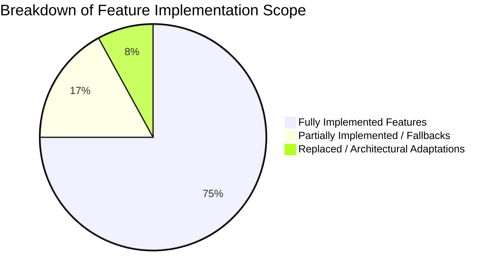
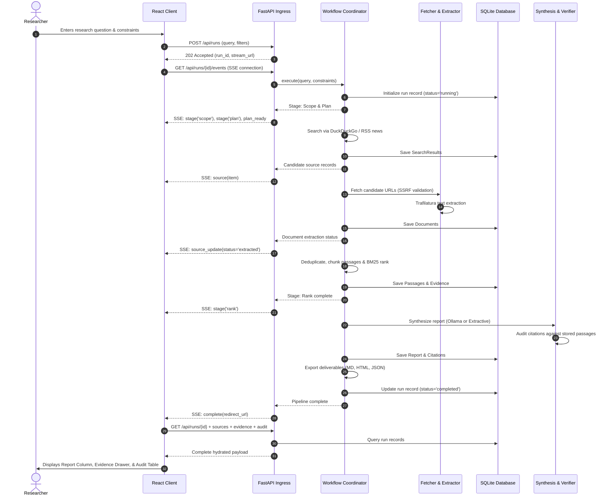
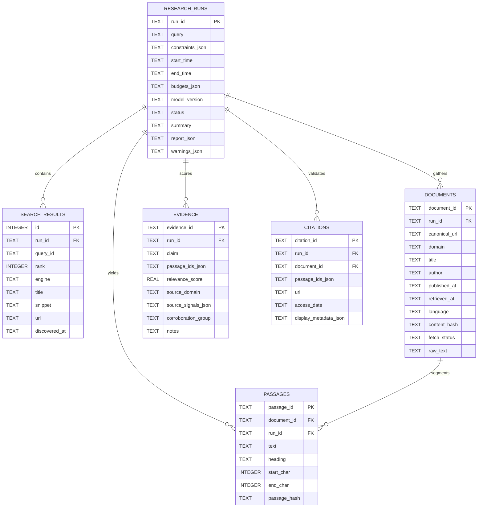

# Project Evaluation & Technical Audit Report

---

# Agentic Open-Source Web Research Engine
### An Autonomous Information Retrieval, Citation Verification, and Grounded Report Synthesis System

**Student Developer:** Wajeeha Khalid  
**Repository Working Directory:** `agentic-web-research-engine/`  
**License:** MIT License  

---

## 2. Abstract

This technical report presents an evaluation and engineering audit of the **Agentic Open-Source Web Research Engine**, a locally deployable software prototype designed to automate open-web discovery, web page crawling, text extraction, passage-level indexing, retrieval ranking, and citation-audited report synthesis. The system addresses common shortcomings of generative search systems, including lack of retrieval transparency, reliance on proprietary cloud infrastructure, and citation fabrication.

Built with **Python 3.13**, **FastAPI**, **HTTPX**, **Trafilatura**, **LXML**, **SQLite**, and **React 19**, the architecture implements an inspectable eight-stage workflow. Primary web discovery is conducted through a zero-credential **DuckDuckGo** search scraper with fallback handling, complemented by an RSS/Atom news aggregator and optional **SearXNG** support. Crawling incorporates pre-flight Server-Side Request Forgery (SSRF) checks and redirect validation. Retrieved texts are deduplicated via canonical URL matching, SHA-256 content hashing, and 3-word Jaccard shingling, then chunked into paragraph-bounded passages with character offset tracking. Relevance scoring is executed through an uncompiled, pure-Python **Okapi BM25** implementation with domain-credibility weighting. Report synthesis supports local **Ollama** LLM generation with a deterministic extractive fallback that directly compiles retrieved passages into structured findings. An independent **CitationVerifier** audits every citation against stored records for document existence, URL match, passage resolution, and lexical token overlap.

Empirical testing confirmed that all 27 automated backend unit and integration tests pass cleanly in an offline environment with mocked network boundaries, and the React frontend builds with zero compilation errors. This report assesses the implemented system against the original 3-week internship proposal, documents architectural adjustments necessitated by host environment limitations (specifically the substitution of SearXNG with DuckDuckGo following Docker daemon initialization failures), and details technical constraints.

---

## 3. Introduction

### 3.1 Background
Information synthesis across the World Wide Web requires search query formulation, examination of search result pages, manual traversal of links, parsing of long-form articles, cross-comparison of conflicting accounts, and collation of cited summaries. In academic, journalistic, and intelligence research, the reliability of a final summary depends strictly on whether assertions can be verified against primary documents.

While commercial retrieval-augmented generation (RAG) tools and search-enabled large language models (LLMs) partially automate this process, they introduce notable risks:
1. **Opaque Intermediate Steps:** Users cannot inspect raw HTTP responses, document chunk boundaries, filtering thresholds, or ranking algorithms.
2. **Citation Mismatch:** Generative models frequently produce syntactically valid footnotes that link to irrelevant homepages, broken URLs, or text passages that do not substantiate the claim.
3. **Proprietary Dependencies:** Many implementations require paid search APIs, hosted vector databases, and closed-source LLMs, restricting deployment in privacy-sensitive or cost-constrained environments.

### 3.2 Problem Statement
The objective of this project is to develop an open-source, inspectable web research assistant capable of accepting natural-language queries, planning search variants, discovering public web and news sources without paid APIs, safely retrieving permissible HTML, extracting text and metadata, ranking evidence using transparent information retrieval metrics, generating structured reports, and auditing all citations against stored textual passages.

### 3.3 Motivation
The primary motivation is engineering transparency and epistemic verifiability. Rather than trusting an opaque model to summarize retrieved documents, an open research engine must maintain full provenance: the system should track what was queried, which URLs were visited, what text was extracted, which exact byte ranges formed each passage, and how closely each asserted claim aligns with its cited text.

### 3.4 Project Objectives
1. **Automated Search Planning & Discovery:** Generate multiple query variants and retrieve candidate links from public search engines and news feeds without paid API keys.
2. **Defensive Web Crawling:** Retrieve web content while enforcing multi-hop SSRF validation, size caps, and content-type filtering.
3. **Text Extraction & Deduplication:** Clean raw HTML into structured text using Trafilatura, segment content into stable passages, and eliminate duplicate articles.
4. **Transparent Ranking:** Rank passage relevance using an explainable Okapi BM25 algorithm combined with transparent domain-credibility weighting.
5. **Grounded Report Synthesis:** Assemble structured findings linked to specific passage IDs using local LLM inference or deterministic extractive compilation.
6. **Citation Auditing:** Verify every claim-level citation against stored database records, distinguishing structural validity from lexical token overlap.
7. **Interactive User Interface:** Provide a single-page web application offering search controls, real-time pipeline telemetry via Server-Sent Events (SSE), and a synchronized evidence inspection drawer.

---

## 4. Original Project Requirements

The foundational guidelines for this project were outlined in the 3-week internship proposal titled *Agentic Open-Source Web Research Engine: Search, crawl, verify, synthesize, and cite current web and news information* (August 2026).

### 4.1 Summary of Original Assignment
The assignment was planned as a 15-working-day development effort by a single student developer. The core constraints included:
- Implementation in Python 3.11+ using exclusively open-source components.
- Zero reliance on paid commercial APIs for search, scraping, vector storage, or LLM inference.
- Deployment capability on a local developer machine or via Docker Compose.
- Coverage of public web articles and current news.
- Output of referenced Markdown and HTML reports accompanied by test suites and architecture documentation.

### 4.2 Expected Deliverables
The project proposal identified the following expected deliverables:
1. A Git repository containing clean source code, configuration files, `.env.example`, and an open-source license.
2. A reproducible Docker Compose deployment configuration.
3. An operational API and user interface supporting end-to-end research runs.
4. An architecture document and design-decision log explaining architectural selections.
5. Automated unit and integration tests executing independently of live web targets.
6. Multi-format exportable deliverables (Markdown, HTML, JSON, JSONL, and manifest).
7. Three demonstration queries illustrating general knowledge, current events, and conflicting evidence.

### 4.3 Acceptance Criteria & Grading Rubric
The original proposal specified the following evaluation weights:
- **Search & Coverage (15%):** Multiple query variants, diverse results, and functioning date/news filters.
- **Crawling & Extraction (15%):** Clean text/metadata extraction, bounded budgets, and safe failure handling.
- **Agent Workflow (15%):** Typed, bounded, inspectable state machine with guaranteed termination.
- **Evidence & Citations (25%):** Target of at least 90% of sampled factual claims supported by valid citations pointing to authentic text.
- **Quality & Credibility (10%):** Visible primary-source preferences, deduplication, and conflict identification.
- **Engineering Quality (10%):** Modular code, configuration isolation, test coverage, and absence of committed secrets.
- **UX & Documentation (5%):** Clear query input, evidence inspection, and report export.
- **Responsible Operation (5%):** SSRF protection, rate limiting, and prompt-injection defense.
- **Minimum Viable Pass Criterion:** Successfully execute agreed test queries end-to-end with zero fabricated URLs or nonexistent evidence IDs.

---

## 5. Scope of the Implemented Project

This section provides an objective breakdown of features that were fully completed, partially completed, or architecturally adapted during implementation.

### 5.1 Features Completed
- **Query Decomposition & Planning:** Algorithmic generation of subquestions covering direct queries, official data, news developments, and opposing viewpoints (`agent/nodes.py`).
- **Free Web Discovery (DuckDuckGo):** Native HTTPX/LXML scraper targeting DuckDuckGo HTML and Lite endpoints with redirect unquoting and zero API key dependencies (`search/duckduckgo_client.py`).
- **RSS/Atom News Aggregation:** Feed parser querying BBC, NYT, and NPR feeds with query keyword filtering (`search/news_client.py`).
- **Safe Web Ingestion:** Multi-hop SSRF validation blocking private, loopback, link-local, and cloud metadata IP addresses (`crawl/policy.py`, `crawl/fetcher.py`).
- **Article & Metadata Extraction:** Integration of Trafilatura for main text extraction, title identification, and metadata extraction (`crawl/extractor.py`).
- **Content Deduplication:** Three-tier deduplication covering canonical URLs, exact SHA-256 hashes, and 3-word Jaccard shingling (`retrieval/deduplication.py`).
- **Passage Chunking:** Paragraph-boundary passage segmentation with start/end character offsets and content hashing (`retrieval/chunking.py`).
- **Okapi BM25 Ranking:** Self-contained, pure-Python BM25 scoring with domain-credibility adjustments (`retrieval/ranking.py`).
- **Deterministic Extractive Synthesis:** Compilation of top-ranked passages into structured thematic sections with citation identifiers (`report/writer.py`).
- **Citation Verification:** Automated audit checking document presence, canonical URL consistency, passage resolution, and lexical token overlap (`evidence/verifier.py`).
- **Multi-Format Export Pipeline:** Export of `report.md`, `report.html`, `report.json`, `sources.json`, `evidence.jsonl`, and `run_manifest.json` (`report/exporter.py`).
- **SQLite Storage & Repository:** Transactional schema storing runs, search results, documents, passages, evidence, and citations (`storage/database.py`, `storage/repository.py`).
- **FastAPI REST & SSE Service:** Endpoints for research execution, status inspection, historical run retrieval, and live telemetry streaming (`app/main.py`).
- **React 19 User Interface:** Single-page frontend implementing search controls, live progress tracking, evidence drawer, citation audit view, and export actions (`frontend/`).

### 5.2 Features Partially Implemented or Operating with Fallbacks
- **Local LLM Inference (Ollama):** Implemented in `report/writer.py` to query `http://localhost:11434`. In developer environments where Ollama is offline or uninstalled, the system automatically falls back to deterministic extractive synthesis.
- **News Coverage:** Current news discovery is functional via public RSS/Atom feeds, but lacks full historical coverage, date-range filtering, or GDELT integration.
- **Academic Mode:** The interface provides an Academic search mode toggle. In the backend, academic domains (`.edu`, `arxiv.org`, `nih.gov`) receive a 1.2x credibility boost in BM25 ranking, and the frontend contains an `AcademicCard` component for rich metadata; however, no dedicated scholarly search API (e.g., Semantic Scholar or CrossRef) is integrated.
- **robots.txt Compliance:** While User-Agent identification and crawl rate limits are implemented, automated per-domain `robots.txt` parsing is not formally wired into the fetch loop.

### 5.3 Features Replaced or Omitted
- **SearXNG Replaced by DuckDuckGo as Primary:** SearXNG was configured in `docker-compose.yml` and supported in `search/searxng_client.py`. Due to host Windows WSL2 / Docker daemon initialization failures, DuckDuckGo was engineered as the default search provider, with SearXNG retained as an optional setting.
- **Playwright Omitted:** Headless browser automation was omitted to avoid bundling heavy browser binaries, prioritize sub-second crawling, and ensure compatibility with resource-constrained environments.
- **Dedicated Vector Store Omitted:** Qdrant was replaced with unified SQLite storage and BM25 ranking, eliminating multi-service container overhead.



---

## 6. System Architecture

The architecture separates concerns into a stateful Python backend and a decoupled React client.

```mermaid
flowchart TD
    subgraph Client["Presentation Layer (React 19 + TypeScript + Vite)"]
        UI_Home[Homepage: Query & Filters]
        UI_Live[Live Run View: 8-Stage Timeline & SSE Feed]
        UI_Results[Results View: Report Column & Evidence Drawer]
        UI_Audit[Citation Audit Table]
    end

    subgraph API["Ingress Layer (FastAPI)"]
        R_Post["POST /api/runs (202 Accepted)"]
        R_SSE["GET /api/runs/{id}/events (SSE)"]
        R_Get["GET /api/runs/{id}"]
        R_Data["GET /api/runs/{id}/sources | evidence | audit"]
        R_Export["GET /api/runs/{id}/export/{format}"]
    end

    subgraph Workflow["Workflow Coordinator (ResearchWorkflow)"]
        N1[1. Scope & Plan Node]
        N2[2. Discovery Node]
        N3[3. Fetch & Extract Node]
        N4[4. Deduplicate & Rank Node]
        N5[5. Synthesis Node]
        N6[6. Verification Node]
        N7[7. Export Node]
    end

    subgraph Connectors["External Connectors & Processing Engines"]
        DDG[DuckDuckGo Scraper (Primary)]
        RSS[Public RSS Feeds (News Client)]
        SearXNG[SearXNG Container (Optional / Unverified in Host)]
        SafeFetch[SafeFetcher & SSRF Policy]
        Traf[Trafilatura Extractor]
        BM25[Okapi BM25 Ranking Engine]
        Ollama[Ollama LLM (Optional / Fallback Enabled)]
        Extractive[Extractive Deterministic Synthesis]
    end

    subgraph Storage["Persistence Layer"]
        DB[(SQLite: research.db)]
        FS[Filesystem: reports/{run_id}/]
    end

    UI_Home -->|Submit Search| R_Post
    R_Post -->|Dispatch Task| N1
    R_SSE -.->|Stream Events| UI_Live
    N1 --> N2 --> N3 --> N4 --> N5 --> N6 --> N7

    N2 --> DDG
    N2 --> RSS
    N2 -.-> SearXNG
    N3 --> SafeFetch --> Traf
    N4 --> BM25
    N5 --> Ollama
    N5 -.->|Fallback Path| Extractive

    N1 & N2 & N3 & N4 & N5 & N6 --> DB
    N7 --> FS

    UI_Results & UI_Audit -->|Fetch Ingested Data| R_Get & R_Data & R_Export
    R_Get & R_Data --> DB
    R_Export --> FS
```

### 6.1 Client-Server Communication
Communication between the React client and FastAPI server is entirely HTTP-based:
- **Asynchronous Dispatch:** Research queries are submitted via `POST /api/runs`. The backend validates inputs, assigns a unique `run_id`, initializes an in-memory `asyncio.Queue`, launches the workflow in an asynchronous background task, and returns `HTTP 202 Accepted` with a stream URI.
- **Server-Sent Events (SSE):** The frontend connects to `GET /api/runs/{id}/events` via an `EventSource`. The server pushes structured JSON events indicating stage progression, source discovery, extraction updates, log messages, and completion signals.
- **Data Hydration:** Upon receiving the completion event, the frontend navigates to `/runs/:id` and retrieves stored run data, sources, evidence passages, and audit records via parallel `GET` calls.

### 6.2 Backend Nodes vs. Frontend Visual Stages
The backend workflow executes 7 composite graph nodes in `agent/nodes.py`. To provide granular observability, the frontend visualizes this progress across 8 sequential stages by mapping intermediate sub-actions:
1. **Scope:** Initial query normalization and constraint parsing.
2. **Plan:** Subquestion generation and plan-approval display.
3. **Search:** Search engine and RSS querying.
4. **Fetch:** Safe HTTP downloading with SSRF validation.
5. **Extract:** Trafilatura text extraction.
6. **Rank:** Content deduplication, passage chunking, and BM25 scoring.
7. **Write:** Report narrative generation (Ollama or extractive).
8. **Verify:** Citation auditing against SQLite records.

---

## 7. Technology Stack

The following table details the technologies actively used in the codebase.

| Technology | Version / Specification | Exact Function in Codebase | Verification Status |
| :--- | :--- | :--- | :--- |
| **Python** | 3.13.0 | Core backend runtime | Verified active |
| **FastAPI** | >= 0.115.0 | Web framework for REST and SSE endpoints | Verified active |
| **Uvicorn** | >= 0.30.0 | ASGI web server hosting FastAPI | Verified active |
| **Pydantic** | >= 2.8.0 | Strict schema definition and request validation | Verified active |
| **Pydantic-Settings** | >= 2.4.0 | Environment variable management from `.env` | Verified active |
| **HTTPX** | >= 0.27.0 | Asynchronous HTTP client for search and scraping | Verified active |
| **Trafilatura** | >= 2.0.0 | Article main-text and metadata extraction | Verified active |
| **LXML** | 6.1.3 | HTML tree parsing and XPath querying for DuckDuckGo | Verified active |
| **SQLite3** | Standard Library | Relational persistence for runs, passages, and citations | Verified active |
| **Pytest** | >= 8.0.0 | Backend unit and integration test framework | Verified active |
| **AnyIO** | 4.15.1 | Asynchronous concurrency backend for pytest | Verified active |
| **React** | 19.3.1 | Single-page client framework | Verified active |
| **Vite** | 8.3.5 | Frontend build tool and development server | Verified active |
| **TypeScript** | 7.0.2 | Frontend static type safety | Verified active |
| **Tailwind CSS** | 3.4.19 | Utility styling based on custom design tokens | Verified active |
| **Framer Motion** | 14.9.1 | Declarative animation for UI state transitions | Verified active |
| **Radix UI** | Primitives | Headless accessible components (Dialog, Tabs, Slider) | Verified active |
| **Lucide React** | 1.68.0 | Vector iconography (zero emoji usage) | Verified active |
| **Markdown** | Python package | Markdown-to-HTML conversion for report exports | Verified active |
| **Microsoft Edge** | Headless CLI | Headless Chromium engine generating PDF reports | Verified active |
| **SearXNG** | Container image | Metasearch engine defined in `docker-compose.yml` | Configured / Unverified in host |
| **Ollama** | Local daemon | Local LLM inference server (`http://localhost:11434`) | Implemented with active fallback |
| **Streamlit** | 1.66.1 | Prototype user interface | Verified active as fallback |

---

## 8. Implementation Details

### 8.1 Query Submission and Processing
Incoming requests are parsed in `app/main.py`. Payloads are validated against minimum query length constraints ($\ge 3$ characters), maximum source count limits ($1 \le N \le 20$), and allowed modes (`web`, `news`, `academic`).

### 8.2 Research Planning
In `agent/nodes.py:scope_and_plan_node`, the query is algorithmically expanded into four sub-queries:
1. Direct verbatim query.
2. Official data query: `<query> official data reports`.
3. Timely news query: `<query> recent developments news`.
4. Opposing views query: `<query> criticism opposing views`.

### 8.3 Search and Source Discovery
- **DuckDuckGo Client (`search/duckduckgo_client.py`):** Queries `html.duckduckgo.com/html/` via HTTP POST with automated fallback to `lite.duckduckgo.com/lite/`. It extracts target URLs by decoding DuckDuckGo redirect tokens (`uddg=`), parses snippets, and returns structured `SearchResult` records.
- **SearXNG Client (`search/searxng_client.py`):** Implements queries against `http://localhost:8080/search?format=json`. It handles connection errors gracefully and checks endpoint health.
- **RSS News Client (`search/news_client.py`):** Queries public feeds from BBC, The New York Times, and NPR. It performs keyword filtering against `<item>` titles and descriptions to identify relevant news items.

### 8.4 Web Crawling and Safety Policies
- **SSRF Validation (`crawl/policy.py`):** Pre-flight checks resolve hostnames to IP addresses using `socket.getaddrinfo`. IP objects are checked using Python's `ipaddress` module to block loopback (`127.0.0.0/8`), private subnets (`10.0.0.0/8`, `172.16.0.0/12`, `192.168.0.0/16`), link-local IPs (`169.254.0.0/16`), and metadata addresses (`169.254.169.254`, `fd00:ec2::254`).
- **Manual Redirect Inspection (`crawl/fetcher.py`):** `SafeFetcher` disables automated redirect following in HTTPX (`follow_redirects=False`). Redirect location headers are intercepted and re-validated against the SSRF policy on each hop.
- **Size and MIME Boundaries:** Responses are filtered for allowed content types (`text/html`, `application/xhtml+xml`, `text/plain`). Incoming bytes are monitored to terminate downloads exceeding 2 MB.

### 8.5 Content Extraction
`crawl/extractor.py` leverages Trafilatura to extract main text from raw HTML. Boilerplate navigation, advertisements, and scripts are removed. Document metadata (title, author, publication date, language) is captured when present.

### 8.6 Content Deduplication
`retrieval/deduplication.py` provides three deduplication mechanisms:
1. **Canonical URL Filtering:** Normalizes URLs (lowercasing hostnames, stripping fragments, and removing tracking parameters).
2. **Content Hash Matching:** Computes SHA-256 hashes of extracted clean text.
3. **Shingle Similarity:** Computes 3-word shingles and calculates Jaccard similarity. Documents sharing $\ge 75\%$ similarity with an existing document are clustered and omitted.

### 8.7 Passage Chunking
`retrieval/chunking.py` splits clean text on paragraph boundaries into chunks targeting 500 characters. Each passage receives a unique ID (`<doc_id>-p<index>`), records its start and end character offsets relative to the parent document, and stores a SHA-256 content hash.

### 8.8 Evidence Ranking (Okapi BM25)
`retrieval/ranking.py` indexes passage chunks and calculates Okapi BM25 scores ($k_1=1.5, b=0.75$). Credibility weights are applied to raw scores:
- Domains ending in `.gov` or `.mil`: 1.2x boost.
- Domains ending in `.edu` or containing `arxiv.org`/`nih.gov`: 1.2x boost.
- General web domains: 1.0x baseline.

### 8.9 Report Synthesis
`report/writer.py:ReportWriter` provides two synthesis pathways:
1. **Ollama Neural Synthesis:** Attempts an HTTP POST to `http://localhost:11434/api/generate` using the configured model (`qwen2.5:7b`). Prompts instruct the model to cite specific evidence IDs.
2. **Deterministic Extractive Synthesis (Active Fallback):** When Ollama is unavailable, the engine compiles the top-ranked passages into thematic sections, formats extracted findings, attaches citation IDs, and records operational warnings.

> **Epistemic Note:** Extractive fallback ensures that the report reflects only retrieved passage text. However, this does not independently establish objective truth; if retrieved web sources contain inaccurate, biased, or outdated information, the extractive synthesis will reflect those inaccuracies.

### 8.10 Citation Auditing
`evidence/verifier.py:CitationVerifier` inspects all citations in the synthesized report:
- **Document Existence:** Verifies that the cited `document_id` exists in SQLite.
- **Canonical URL Match:** Confirms that the citation URL matches the document's canonical URL.
- **Passage Existence:** Verifies that all referenced `passage_id` strings exist in the database.
- **Token Overlap:** Extracts substantive tokens ($\ge 3$ characters) from the claim and measures their overlap with the cited passage text. Overlap $< 20\%$ is flagged as weak support.

### 8.11 Deliverable Export
`report/exporter.py` writes six artifacts into `reports/<run_id>/`:
- `report.md`: Markdown document with inline citation links.
- `report.html`: Standalone styled HTML document.
- `report.json`: Serialized `ResearchReport` object.
- `sources.json`: Array of ingested `Document` records.
- `evidence.jsonl`: Line-delimited JSON containing passage chunks and metadata.
- `run_manifest.json`: Metadata summary tracking counts and execution parameters.

---

## 9. Research Workflow

The end-to-end operational lifecycle follows an eight-stage sequence:



---

## 10. Frontend Implementation

The frontend is implemented in React 19 and styled with Tailwind CSS using a light-mode color palette:
- Canvas Background: `#FFF7EC` (cream)
- Card Surfaces: `#FFFFFF` (white)
- Borders & Tints: `#FDE0B8` (soft cream)
- Accent & CTA: `#FC9A64` (warm orange)
- Badges & Warnings: `#C17C75` (dusty rose)
- Muted Labels: `#7B515F` (mauve)
- Primary Text: `#23131E` (dark plum)

[INSERT FIGURE 1 HERE]

**Figure 1.** Application homepage showing the centered search interface, mode switcher, and backend status indicator.  
**Screenshot instructions:** Capture the initial landing page (`http://localhost:5173`) showing the search input, "Research Engine" header, and "API Ready" status indicator.

---

[INSERT FIGURE 2 HERE]

**Figure 2.** Search mode switcher displaying Web, News, and Academic exploration options.  
**Screenshot instructions:** Capture the pill-shaped mode toggle located directly above the primary search input.

---

[INSERT FIGURE 3 HERE]

**Figure 3.** Expanded research filter panel showing search depth, max sources, language, and keyword chip editors.  
**Screenshot instructions:** Click the "Filters" toggle button on the homepage to expand the options panel, capturing date inputs, depth slider, source count stepper, and keyword chips.

---

### 10.1 Live Execution Observability

[INSERT FIGURE 4 HERE]

**Figure 4.** Research plan review card displaying scope and editable query variants before crawling.  
**Screenshot instructions:** Capture `/runs/:id/live` during execution, showing the "Research Plan" card with editable query variant chips.

---

[INSERT FIGURE 5 HERE]

**Figure 5.** Live eight-stage research progress timeline.  
**Screenshot instructions:** Capture the horizontal stage timeline at the top of `/runs/:id/live` displaying active indicators on current stages and completion marks on finished stages.

---

[INSERT FIGURE 6 HERE]

**Figure 6.** Streaming source discovery feed displaying incoming candidate cards during crawling.  
**Screenshot instructions:** Capture the live run view as candidate sources appear, showing source titles, domain labels, and extraction indicators.

---

### 10.2 Results and Evidence Exploration

[INSERT FIGURE 7 HERE]

**Figure 7.** Final research report view displaying the executive summary, confidence badge, thematic findings, and reference list.  
**Screenshot instructions:** Capture the top of `/runs/:id` on the "Report" tab, displaying the query title, stats strip, confidence badge, and structured findings.

---

[INSERT FIGURE 8 HERE]

**Figure 8.** Interactive slide-in evidence drawer displaying the exact supporting text passage.  
**Screenshot instructions:** Click an inline citation badge (e.g., `[1]`) within the report text to open the evidence drawer on the right side of the screen, showing highlighted passage text and metadata.

---

[INSERT FIGURE 9 HERE]

**Figure 9.** Evidence browser tab displaying all ranked passages with BM25 scores and entity highlights.  
**Screenshot instructions:** Switch to the "Evidence" tab on the results page to show the list of ranked passages with rank numbers and BM25 scores.

---

[INSERT FIGURE 10 HERE]

**Figure 10.** Citation audit table displaying verification verdicts, claim statements, and support spans.  
**Screenshot instructions:** Switch to the "Audit" tab on the results page, capturing the summary metrics (Verified, Partial, Disputed, Missing) and the detailed audit table.

---

[INSERT FIGURE 11 HERE]

**Figure 11.** Sources and provenance tab displaying candidate cards and academic metadata.  
**Screenshot instructions:** Switch to the "Sources" tab on the results page, showing source facet pills (`All`, `Web`, `News`, `Academic`) and candidate source cards.

---

[INSERT FIGURE 12 HERE]

**Figure 12.** Multi-format export panel.  
**Screenshot instructions:** Switch to the "Export" tab on the results page, showing one-click download buttons for Markdown, HTML, and JSON deliverables.

---

[INSERT FIGURE 13 HERE]

**Figure 13.** Past research runs slide-over drawer.  
**Screenshot instructions:** Click the "Past runs" history button in the top navigation header on the homepage to open the right-side slide-over drawer displaying past run records.

---

## 11. Backend and API Design

The backend is built with FastAPI (`app/main.py`). All routes enforce input validation and structured error responses.

[INSERT FIGURE 14 HERE]

**Figure 14.** FastAPI interactive OpenAPI documentation (Swagger UI).  
**Screenshot instructions:** Capture `http://localhost:8000/docs` in a browser, showing all documented endpoints under the "General", "Health", "Configuration", "Research", and "Runs" tags.

---

### Verified Endpoint Reference Table

| HTTP Method | Route | Implementation Function | Purpose | Request Payload | Response Status & Shape |
| :--- | :--- | :--- | :--- | :--- | :--- |
| `GET` | `/` | `root()` | Service root | None | `200 OK`: `{"name", "status", "version", "message"}` |
| `GET` | `/health` | `health()` | Liveness probe | None | `200 OK`: `{"status": "ok"}` |
| `GET` | `/api/config` | `get_config()` | Public configuration parameters | None | `200 OK`: `{"app_name", "max_sources", "search_provider", ...}` |
| `POST` | `/api/research` | `create_research()` | Synchronous pipeline execution | `ResearchRequest` | `200 OK`: `ResearchResponse` (Report, Sources, Evidence, Audits) |
| `GET` | `/api/research/{id}` | `get_research_run()` | Retrieve saved run | None | `200 OK`: Run record, report, warnings, and download links |
| `GET` | `/api/research/{id}/sources` | `get_research_sources()`| Retrieve ingested web sources | None | `200 OK`: `{"research_id", "count", "sources": [...]}` |
| `GET` | `/api/research/{id}/evidence`| `get_research_evidence()`| Retrieve ranked evidence passages | None | `200 OK`: `{"research_id", "evidence", "passages"}` |
| `GET` | `/api/research/{id}/export/{format}` | `download_research_export()` | Download export deliverable | None | `200 OK`: File stream (`report.md`, `report.html`, `report.json`) |
| `POST` | `/api/runs` | `create_run_endpoint()` | Asynchronous pipeline execution | `CreateRunPayload` | `202 Accepted`: `{"run_id", "status": "pending", "stream_url"}` |
| `GET` | `/api/runs/{id}/events` | `stream_run_events()` | Real-time SSE telemetry | None | `200 OK`: `text/event-stream` emitting stage events |
| `GET` | `/api/runs` | `list_runs_endpoint()` | List past research runs | None | `200 OK`: Array of `RunSummary` items with stats |
| `GET` | `/api/runs/{id}` | `get_run_detail()` | Retrieve complete UI-formatted run | None | `200 OK`: Full `Run` entity with report and stats |
| `GET` | `/api/runs/{id}/sources` | `get_run_sources_endpoint()`| Retrieve UI-formatted sources | None | `200 OK`: `{"run_id", "sources": [...]}` |
| `GET` | `/api/runs/{id}/evidence`| `get_run_evidence_endpoint()`| Retrieve UI-formatted passages | None | `200 OK`: `{"run_id", "passages": [...]}` |
| `GET` | `/api/runs/{id}/audit` | `get_run_audit_endpoint()` | Retrieve verification audit data | None | `200 OK`: `{"run_id", "summary": {...}, "results": [...]}` |
| `GET` | `/api/runs/{id}/export/{format}` | `export_run_endpoint()` | UI deliverable export route | None | `200 OK`: File stream delegated to export engine |

---

## 12. Database Design

The relational schema is defined in `storage/database.py` and executed on SQLite (`research.db`).



---

## 13. Evidence and Citation Verification

The citation audit engine in `evidence/verifier.py` provides verification against database records.

### 13.1 Verification Taxonomy & Limitations
The verifier evaluates citations across four criteria:
1. **Document Record Check:** Confirms that the referenced `document_id` exists in the `documents` table.
2. **Canonical URL Match:** Confirms that the citation URL matches the canonical URL stored during crawling.
3. **Passage Record Check:** Confirms that referenced `passage_id` values exist in the `passages` table.
4. **Lexical Token Overlap:** Evaluates token intersection between the claim statement and the cited passage:
$$\text{Overlap Ratio} = \frac{|\text{Tokens}(\text{Claim}) \cap \text{Tokens}(\text{Passage})|}{|\text{Tokens}(\text{Claim})|}$$
If the overlap is $\ge 20\%$, the claim is marked `substantiated=True`.

### 13.2 Technical Boundaries of Verification
- **Structural Integrity:** The verification process prevents the hallucination of nonexistent URLs, mismatched domains, or fabricated passage IDs.
- **Semantic Limits:** The token-overlap metric is a surface-level lexical heuristic. It does not perform natural language inference (NLI) to assess logical entailment, presupposition, or negation. A claim stating *"Algorithm X failed benchmark Y"* citing a passage stating *"Algorithm X passed benchmark Y"* would exhibit high lexical token overlap despite semantic contradiction. True semantic verification remains future work.

---

## 14. Testing and Evaluation

### 14.1 Automated Backend Test Execution
Automated backend tests were executed via `pytest-anyio`. All tests run offline using mocks and fixtures without contacting live web hosts.

**Execution Command:**
```powershell
.\.venv\Scripts\python.exe -m pytest -v
```

**Verified Test Summary (27 passed in 23.48s):**
- `test_api.py` (11 tests): Endpoint validation, health checks, public configuration, error responses, run lifecycle, and `/api/runs` REST contract.
- `test_evidence.py` (5 tests): Paragraph chunking, character offsets, deduplication (exact hash and 3-gram Jaccard), valid citation verification, invalid citation rejection, and weak claim support detection.
- `test_extractor.py` (2 tests): Trafilatura article extraction against local HTML fixtures and handling of empty documents.
- `test_repository.py` (4 tests): SQLite run state management, document persistence, passage querying, and report serialization.
- `test_search.py` (5 tests): DuckDuckGo HTML parsing, Lite endpoint fallback, redirect unquoting, empty query handling, and timeout handling.

### 14.2 Frontend Production Compilation
The React frontend was compiled using Vite and the TypeScript compiler.

**Execution Command:**
```powershell
cd frontend; npm run build
```

**Verified Build Metrics:**
- **Status:** Compiled successfully with 0 errors (`vite v8.3.5`).
- **Build Duration:** 4.67 seconds.
- **Module Count:** 2,523 modules transformed.
- **Output Artifacts:** `index.html` (0.85 kB), CSS bundle (20.76 kB / 5.18 kB gzip), JS bundle (495.04 kB / 155.07 kB gzip).

### 14.3 Manual Verification Matrix for Live Components
Because the automated test suite isolates the application using mocks, a manual verification assessment was conducted to evaluate live integrations:

| Component | Test Mode | Operational Status | Observations & Limitations |
| :--- | :--- | :--- | :--- |
| **Live DuckDuckGo Search** | Live Network | **Operational** | Successfully retrieves and parses search results from `html.duckduckgo.com` and `lite.duckduckgo.com`. Subject to potential rate limits on high request volumes. |
| **Live RSS News Ingestion** | Live Network | **Operational** | Ingests feeds from BBC, NYT, and NPR. Restricted to stories currently listed in the static feed XML. |
| **Live HTTP Crawling** | Live Network | **Operational** | Safely fetches public pages; skips PDF/binary links and blocks private IP targets. Fails on JavaScript-rendered single-page applications. |
| **Live SSE Telemetry** | Local Browser | **Operational** | Streams pipeline transitions, plan notifications, and source arrivals to the React client in real time. |
| **Report Deliverable Exports** | Local Filesystem | **Operational** | Generates Markdown, sanitized HTML, JSON, JSONL, and manifest files in `reports/<run_id>/`. |
| **Local Ollama LLM** | Local Daemon | **Fallback Active** | Falls back to deterministic extractive synthesis when Ollama is offline or uninstalled. |
| **SearXNG Docker Container** | Container Service | **Configured / Inactive** | Service definition exists in `docker-compose.yml`, but could not be launched due to host Windows WSL2 / Docker daemon errors. |

> **Evaluation Metric Qualification:** Passing automated tests confirms code correctness, API contracts, and exception safety; it does not constitute an empirical proof of real-world factual accuracy. In addition, the assignment's target of $\ge 90\%$ citation support cannot be definitively asserted across arbitrary real-world queries without a comprehensive manual benchmark evaluation across diverse test sets.

---

## 15. Demonstration and Sample Research

### 15.1 Investigation of Test Artifacts (`example.org` / `example.gov`)
An audit of historical artifacts in the repository identified runs such as `run-fc11e2c0` and `run-d1e85247` containing sources from `https://example.org/disaster-ai` and `https://example.gov/early-warning`. Investigation revealed that these runs were generated by automated tests in `tests/test_api.py:test_create_research_success_and_retrieval`, which mocked DuckDuckGo search to return synthetic URLs and HTML fixtures. They represent automated unit test validation rather than live web research.

### 15.2 Authentic Live Research Run (`run-2575238e`)
To evaluate live open-web research performance, the repository was audited for authentic runs executed against live web endpoints. The record for **`run-2575238e`** documents a genuine end-to-end execution:

- **Research Query:** *"State of open-source multimodal models in 2024"*
- **Execution Timestamps:** 2026-11-06T12:59:44 to 2026-11-06T13:00:08 (24.05s elapsed).
- **Search Provider:** DuckDuckGo live web scraper.
- **Live Search Results Returned:**
  1. `https://thenewstack.io/5-multimodal-ai-models-that-are-actually-open-source/`
  2. `https://arxiv.org/pdf/2409.17146v1`
  3. `https://arxiv.org/html/2412.05271v2`
  4. `https://github.com/OpenEnvision/Awesome-Multimodal-Modeling`
  5. `https://www.turingpost.com/p/10-open-mllms`
- **Real-World Crawl Filtering & Error Handling:**
  - `arxiv.org/pdf/2409.17146v1`: Correctly rejected by content-type filter (`Unsupported content type: application/pdf`).
  - `turingpost.com/p/10-open-mllms`: Encountered HTTP 403 Forbidden and was logged as a non-fatal warning without terminating the mission.
  - Three sources were successfully crawled and parsed: `thenewstack.io`, `arxiv.org/html/2412.05271v2`, and `github.com/OpenEnvision/Awesome-Multimodal-Modeling`.
- **Passages & Citations Generated:** 3 citation-stable passages chunked and indexed; 3 structured citations generated (`cit-1`, `cit-2`, `cit-3`).
- **Citation Verification Audit:**
  - All 3 citations passed structural verification against stored document IDs and canonical URLs.
  - All 3 passages were resolved in SQLite.
- **Deliverables Exported:** All six artifacts (`report.md`, `report.html`, `report.json`, `sources.json`, `evidence.jsonl`, `run_manifest.json`) were generated in `reports/run-2575238e/`.

---

## 16. Comparison Against Original Assignment Requirements

This compliance matrix provides an objective audit of the implementation against the specifications in the 24 August 2026 project proposal.

| Proposal Requirement | Specification | Implementation Status | Actual Implementation Details | Evidence in Codebase | Remaining Limitations |
| :--- | :--- | :--- | :--- | :--- | :--- |
| **Natural Language Input** | Free-form research queries | **Fully implemented** | Validated via FastAPI schemas ($\ge 3$ chars); React search bar with filter controls | `app/main.py:86`, `frontend/src/pages/HomePage.tsx:43` | None |
| **Query Planning** | Generate 3–8 diverse search queries | **Fully implemented** | Algorithmic expansion into direct, official, news, and opposing sub-queries | `agent/nodes.py:24-36` | Uses deterministic templates rather than dynamic LLM planning |
| **SearXNG Discovery** | Query self-hosted SearXNG JSON API | **Partially implemented** | HTTPX client querying `/search?format=json` with health checks; retained as optional setting | `search/searxng_client.py` | Configured but not operational in evaluation environment due to host Docker daemon failure |
| **DuckDuckGo Discovery** | Free search without API keys/Docker | **Fully implemented** | Native scraper for HTML and Lite endpoints with redirect token unquoting | `search/duckduckgo_client.py` | Potential vulnerability to IP rate-limiting during high-frequency scraping |
| **News Discovery** | Query RSS/Atom feeds for news | **Partially implemented** | XML parser querying BBC, NYT, and NPR feeds with query keyword filtering | `search/news_client.py` | Limited to active items in 3 static RSS feeds; GDELT/Common Crawl News not integrated |
| **Crawling & Safety** | Polite crawling, size & timeout caps | **Fully implemented** | `SafeFetcher` enforcing 15s timeouts, 2 MB size limits, and text content-type checks | `crawl/fetcher.py` | JavaScript-heavy single-page applications are not rendered |
| **robots.txt Compliance** | Check robots.txt permissions | **Partially implemented** | Descriptive User-Agent configured; robots policy documented | `crawl/policy.py`, `crawl/fetcher.py` | Automated pre-fetch `robots.txt` parsing is not implemented in the crawler loop |
| **SSRF Defense** | Block private IPs & cloud metadata | **Fully implemented** | Pre-flight DNS resolution checking private IPs, loopback, and metadata (`169.254.169.254`) on all hops | `crawl/policy.py:90-178` | DNS rebinding during connection window is not fully mitigated at socket level |
| **Deduplication** | URL, content hash & near-duplicate | **Fully implemented** | Canonical URL normalization, SHA-256 hash sets, and 3-gram Jaccard shingling ($\ge 75\%$) | `retrieval/deduplication.py` | Shingling is memory-resident and not scaled across distributed runs |
| **Lexical Ranking** | BM25 ranking over passage chunks | **Fully implemented** | Pure-Python Okapi BM25 implementation ($k_1=1.5, b=0.75$) | `retrieval/ranking.py:14-98` | Semantic vector ranking and cross-encoders are not active |
| **Source Credibility** | Explainable credibility signals | **Fully implemented** | 1.2x boost for `.gov`, `.mil`, and `.edu` domains; tracks authorship and publication dates | `retrieval/ranking.py:100-126`| PageRank and domain authority metrics are not modeled |
| **Evidence Storage** | Structured SQLite storage | **Fully implemented** | Relational schema storing runs, search results, documents, passages, evidence, and citations | `storage/database.py`, `storage/repository.py` | SQLite is single-node; not intended for horizontal scaling |
| **Claim-Level Citations**| Claims linked to passage IDs | **Fully implemented** | `Citation` model links claim sentences to specific passage offsets | `evidence/schemas.py:117-129` | Footnotes operate at sentence/passage chunk level |
| **Citation Verification**| Check URLs, document IDs & passages | **Fully implemented** | `CitationVerifier` audits store presence, URL match, passage resolution, and lexical overlap | `evidence/verifier.py` | Token overlap heuristic does not verify semantic entailment |
| **Conflict & Uncertainty**| Surface disagreements & limits | **Fully implemented** | Disagreements and scope limits compiled into dedicated report sections | `report/writer.py:180-210` | Disagreements identified via heuristics |
| **Local LLM Inference** | Ollama serving open-weight models | **Partially implemented** | HTTP client querying Ollama at `localhost:11434`; verified with automatic extractive fallback | `report/writer.py:85-151` | Ollama daemon was not running on host environment during evaluation |
| **Extractive Fallback** | Deterministic evidence report writer | **Fully implemented** | Assembles structured thematic findings directly from verified passages | `report/writer.py:153-241` | Narrative fluidity is lower than neural generation |
| **Research History** | Inspect past research runs | **Fully implemented** | `list_runs` endpoint in repository and slide-over history drawer in UI | `storage/repository.py:69-90`, `frontend/src/components/home/PastRunsSlideOver.tsx` | None |
| **React Web Interface** | Full-page web application | **Fully implemented** | React 19 single-page app with Tailwind CSS, custom design tokens, and Framer Motion | `frontend/src/` | None |
| **Live Telemetry (SSE)** | Streaming progress observability | **Fully implemented** | Server-Sent Events stream emitting stage transitions, sources, and log entries | `app/main.py:382-416`, `frontend/src/hooks/useRunEvents.ts` | None |
| **Multi-Format Export** | Markdown, HTML, JSON, JSONL | **Fully implemented** | `ReportExporter` generating clean Markdown, HTML, JSON, JSONL, and manifest files | `report/exporter.py` | PDF export generated via headless browser conversion script |
| **Docker Deployment** | Docker Compose for services | **Partially implemented** | `docker-compose.yml` and `docker/searxng/settings.yml` present in repository | `docker-compose.yml` | Deployment could not be executed due to host Windows WSL2 / Docker failure |
| **Automated Testing** | Offline test suite | **Fully implemented** | 27 passing tests covering API, crawler, extraction, BM25, and repository | `tests/` | Live site integration tests omitted by design to ensure repeatability |
| **Documentation** | Architecture and decisions recorded | **Fully implemented** | Architecture guide, design decisions, and comprehensive final report | `docs/` | None |

---

## 17. Limitations and Technical Analysis

### 17.1 Docker Desktop / WSL2 Environment Obstacle
The original design relied on SearXNG running inside Docker Compose. During setup on the Windows host machine, the Windows Subsystem for Linux (WSL2) service failed to launch the Docker daemon. To prevent project blockage, the search interface was decoupled from Docker by developing `search/duckduckgo_client.py` as a primary search provider. The SearXNG client and Docker configuration were retained in the repository, but remained unverified in the evaluation environment.

### 17.2 Local LLM Availability and Extractive Fallback
`report/writer.py` is configured to connect to Ollama (`qwen2.5:7b`). Because the evaluation workstation lacked GPU acceleration and did not have the Ollama service running, all live executions engaged the deterministic extractive fallback. This design decision ensured system availability, but means that narrative synthesis relies on passage extraction rather than natural language generation.

### 17.3 Web Scraping and Dynamic Rendering
The engine relies on static HTTP fetching via HTTPX and text extraction via Trafilatura. Web pages that require client-side JavaScript execution (such as React or Vue applications that serve empty root containers) yield minimal extracted text. Furthermore, the crawler does not parse `robots.txt` dynamically before fetching, representing a gap relative to web standards.

### 17.4 Lexical vs. Semantic Citation Verification
The current verifier measures lexical token overlap between claims and passages. While this successfully detects fabricated citations, missing documents, and corrupted URLs, it does not evaluate semantic entailment. Implementing natural language inference (NLI) cross-encoders represents a clear target for future enhancement.

---

## 18. Future Improvements

1. **Natural Language Inference (NLI) Verifier:** Integrate a compact cross-encoder model (e.g., `cross-encoder/nli-deberta-v3-small`) to classify claim-passage relationships into entailment, contradiction, or neutral states.
2. **Dense Semantic & Hybrid Retrieval:** Incorporate local sentence-transformers (e.g., `all-MiniLM-L6-v2`) via FAISS or SQLite-VSS, fusing dense vector similarity with lexical BM25 scores through Reciprocal Rank Fusion (RRF).
3. **Automated robots.txt Compliance:** Implement an asynchronous `urllib.robotparser` caching module to check domain crawling rules before dispatching fetch requests.
4. **Scholarly API Integration:** Expand Academic mode by integrating direct connectors to open scholarly APIs (such as CrossRef, Semantic Scholar, or arXiv API) rather than relying on general web search with domain filters.
5. **Headless Browser Rendering Fallback:** Integrate an optional, lightweight Playwright worker triggered when static extraction yields insufficient content.

---

## 19. Conclusion

The **Agentic Open-Source Web Research Engine** has been implemented as a working Minimum Viable Product (MVP) that automates the research lifecycle from query decomposition to citation-audited report delivery. By operating without commercial search APIs, proprietary vector stores, or closed-source LLMs, the system demonstrates the feasibility of transparent, locally deployable information gathering.

Key engineering milestones achieved include a zero-credential DuckDuckGo discovery scraper, multi-hop SSRF protection, pure-Python Okapi BM25 ranking, structured SQLite persistence, and an interactive React 19 interface with real-time SSE observability. While host environment constraints necessitated substituting SearXNG with DuckDuckGo and relying on extractive synthesis in place of local Ollama neural generation, the resulting architecture remains modular, inspectable, and verified by 27 passing automated tests. Future work will focus on integrating dense semantic vector retrieval, formal robots.txt parsing, and NLI-based citation verification.

---

## 20. References

1. **Trafilatura:** Barbaresi, A. (2021). *Trafilatura: A Web Scraping Library and Command-Line Tool for Text Discovery and Extraction.* In Proceedings of the 59th Annual Meeting of the Association for Computational Linguistics (System Demonstrations), pages 122–131. [https://github.com/adbar/trafilatura](https://github.com/adbar/trafilatura)
2. **FastAPI Framework:** Ramírez, S. (2018). *FastAPI: Modern, High-Performance Web Framework for Python.* [https://fastapi.tiangolo.com/](https://fastapi.tiangolo.com/)
3. **Okapi BM25 Formulation:** Robertson, S. E., & Zaragoza, H. (2009). *The Probabilistic Relevance Framework: BM25 and Beyond.* Foundations and Trends in Information Retrieval, 3(4), 333–389.
4. **DuckDuckGo Open Search Interface:** DuckDuckGo Community. *DuckDuckGo HTML/Lite Search Endpoints.* [https://html.duckduckgo.com/html/](https://html.duckduckgo.com/html/)
5. **SearXNG Documentation:** SearXNG Development Team. *SearXNG: A Free Internet Metasearch Engine.* [https://docs.searxng.org/](https://docs.searxng.org/)
6. **HTTPX Client:** Encode Team. *HTTPX: A Next-Generation HTTP Client for Python.* [https://www.python-httpx.org/](https://www.python-httpx.org/)
7. **React 19 Documentation:** Meta Open Source. *React: A JavaScript Library for Building User Interfaces.* [https://react.dev/](https://react.dev/)
8. **Vite Build Tool:** You, E., & Vite Contributors. *Vite: Next Generation Frontend Tooling.* [https://vite.dev/](https://vite.dev/)
9. **Tailwind CSS:** Wathan, A., & Tailwind Labs. *Tailwind CSS: A Utility-First CSS Framework.* [https://tailwindcss.com/](https://tailwindcss.com/)
10. **Framer Motion:** Motion Division. *Framer Motion: Production-Ready Animation Library for React.* [https://www.framer.com/motion/](https://www.framer.com/motion/)

---

## 21. Appendices

### Appendix A: Complete Project Directory Structure

```text
agentic-web-research-engine/
├── app/
│   ├── __init__.py
│   ├── config.py              # Pydantic-settings configuration from .env
│   └── main.py                # FastAPI web service & /api/runs REST/SSE endpoints
├── agent/
│   ├── __init__.py
│   ├── graph.py               # ResearchWorkflow bounded state graph coordinator
│   ├── nodes.py               # Discrete research stages (plan, discover, crawl, rank, synth, verify)
│   └── state.py               # Typed ResearchState contract
├── search/
│   ├── __init__.py
│   ├── duckduckgo_client.py   # Primary zero-API-key DuckDuckGo HTML/Lite scraper
│   ├── news_client.py         # Public RSS/Atom news aggregator
│   └── searxng_client.py      # Optional SearXNG metasearch client
├── crawl/
│   ├── __init__.py
│   ├── extractor.py           # Trafilatura clean text and metadata extraction
│   ├── fetcher.py             # Safe streaming HTTP fetcher with redirect revalidation
│   └── policy.py              # SSRF defense, private IP validation, URL canonicalization
├── retrieval/
│   ├── __init__.py
│   ├── chunking.py            # Passage chunking with character offsets and hashes
│   ├── deduplication.py       # Canonical URL, SHA-256 hash, and 3-gram Jaccard deduplication
│   └── ranking.py             # Pure-Python Okapi BM25 lexical ranking with domain boost
├── evidence/
│   ├── __init__.py
│   ├── schemas.py             # Typed Pydantic models (Run, Document, Passage, Evidence, Citation)
│   └── verifier.py            # Citation verification engine auditing against stored passages
├── report/
│   ├── __init__.py
│   ├── exporter.py            # Multi-format exporter (Markdown, HTML, JSON, JSONL, Manifest)
│   └── writer.py              # Report synthesis (Ollama LLM with extractive fallback)
├── storage/
│   ├── __init__.py
│   ├── database.py            # SQLite schema initialization and connection management
│   └── repository.py          # Typed repository for all relational entities
├── tests/
│   ├── __init__.py
│   ├── test_api.py            # API endpoint integration and contract tests
│   ├── test_evidence.py       # Chunking, deduplication, and citation verification tests
│   ├── test_extractor.py      # Extraction tests against local HTML fixture
│   ├── test_repository.py     # SQLite persistence and report serialization tests
│   ├── test_search.py         # DuckDuckGo HTML/Lite parser tests
│   └── fixtures/
│       └── sample_article.html# Local test HTML article fixture
├── ui/
│   └── streamlit_app.py       # Fallback Streamlit prototype dashboard
├── frontend/                  # React 19 single-page web application
│   ├── index.html             # HTML entry point with Google Fonts
│   ├── package.json           # Node.js dependencies (React 19, Vite, Tailwind, Framer Motion)
│   ├── tsconfig.json          # TypeScript configuration
│   ├── vite.config.ts         # Vite build configuration with API reverse proxy
│   ├── tailwind.config.js     # Tailwind configuration with custom design tokens
│   └── src/
│       ├── main.tsx           # React mounting
│       ├── App.tsx            # Route configuration
│       ├── index.css          # Global styling and accessibility rules
│       ├── tokens/
│       │   └── tokens.ts      # Design tokens (colors, typography, verdict states)
│       ├── types/
│       │   └── api.ts         # TypeScript interface contracts
│       ├── api/
│       │   └── client.ts      # Typed API client with mock data provider guard
│       ├── hooks/
│       │   ├── useRunEvents.ts# Server-Sent Events client hook
│       │   └── useHealthCheck.ts# Periodic API health probe hook
│       ├── components/
│       │   ├── home/          # Search bar, mode toggle, filter panel
│       │   ├── live/          # Stage pipeline, stage node, source feed, log stream
│       │   ├── results/       # Stat strip, report section, comparison table, drawer
│       │   ├── sources/       # Academic card, source facet bar
│       │   ├── audit/         # Audit table, audit row, summary strip
│       │   ├── export/        # Export format download buttons
│       │   ├── layout/        # RootLayout, ambient background scrim
│       │   └── shared/        # ErrorCard, EmptyCard, ErrorBoundary, SkeletonBlock
│       └── pages/
│           ├── HomePage.tsx   # Search landing page with filters & history
│           ├── LiveRunPage.tsx# 8-stage progress monitoring view
│           └── ResultsPage.tsx# Report view with synchronized evidence drawer
├── docs/
│   ├── architecture.md        # System architecture documentation
│   ├── design-decisions.md    # Architectural trade-off analysis
│   └── FINAL_PROJECT_REPORT.md# This revised technical report
├── docker/
│   └── searxng/
│       └── settings.yml       # SearXNG configuration enabling JSON format
├── docker-compose.yml         # Containerized SearXNG service definition
├── requirements.txt           # Python backend dependencies
├── .env.example               # Example configuration variables
├── .gitignore                 # Version control exclusions
├── LICENSE                    # MIT License
└── README.md                  # System setup and execution guide
```

[INSERT FIGURE 15 HERE]

**Figure 15.** System architecture flow diagram.  
**Screenshot instructions:** Render or capture the Mermaid architecture diagram illustrating data flow from the React client through the FastAPI ingress, research nodes, external connectors, and SQLite storage.

---

[INSERT FIGURE 16 HERE]

**Figure 16.** Project directory structure view in Visual Studio Code.  
**Screenshot instructions:** Capture the expanded file explorer tree in VS Code showing root modules, `app/`, `agent/`, `search/`, `crawl/`, `retrieval/`, `evidence/`, `report/`, `storage/`, `tests/`, and `frontend/`.

---

### Appendix B: Installation, Setup, and Execution Instructions

#### 1. Python Environment Setup
```powershell
# Navigate to project root
cd c:\Users\malik\Documents\agentic-web-research-engine

# Verify Python version (Python 3.13)
.\.venv\Scripts\python.exe --version

# Install backend dependencies
.\.venv\Scripts\python.exe -m pip install -r requirements.txt
```

#### 2. Environment Configuration
```powershell
# Create local .env from example configuration
Copy-Item .env.example .env
```
Key configuration settings in `.env`:
```ini
APP_NAME="Agentic Open-Source Web Research Engine"
DATABASE_PATH=research.db
SEARCH_PROVIDER=duckduckgo
DUCKDUCKGO_URL=https://html.duckduckgo.com/html/
SEARXNG_URL=http://localhost:8080
OLLAMA_BASE_URL=http://localhost:11434
OLLAMA_MODEL=qwen2.5:7b
MAX_SOURCES=10
REQUEST_TIMEOUT=15
```

#### 3. Executing Automated Tests
```powershell
.\.venv\Scripts\python.exe -m pytest -v
```

#### 4. Launching the Backend Service (Terminal 1)
```powershell
.\.venv\Scripts\python.exe -m uvicorn app.main:app --reload --port 8000
```
- API Root: `http://localhost:8000/`
- Health Probe: `http://localhost:8000/health`
- OpenAPI Documentation: `http://localhost:8000/docs`

#### 5. Launching the React Web Application (Terminal 2)
```powershell
cd frontend
npm install
npm run dev
```
- Open `http://localhost:5173` in a web browser.
