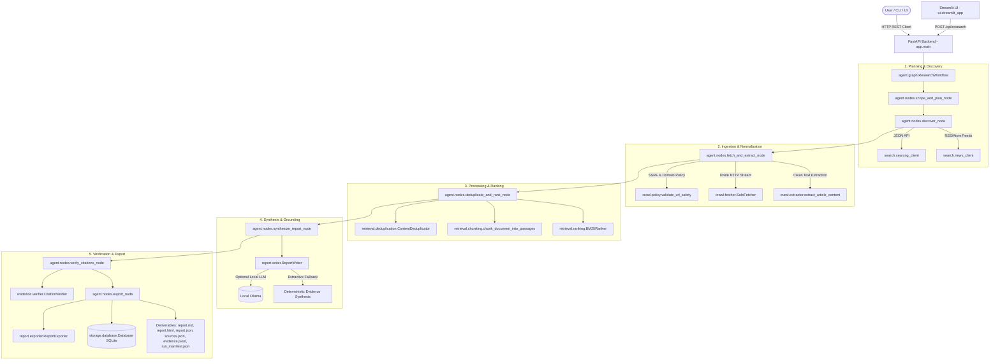

# Architecture Documentation

The **Agentic Open-Source Web Research Engine** is a bounded, locally deployable research assistant designed to convert a natural language research query into an evidence-backed, verifiable report.

The system relies strictly on self-hostable open-source components, avoiding proprietary search APIs, cloud vector databases, or commercial LLM endpoints.

---

## High-Level Architecture Flow

---

## Core API Endpoints

The FastAPI backend exposes the following REST interface:

| Endpoint | Method | Description |
| :--- | :--- | :--- |
| `/` | `GET` | Welcome endpoint with engine name, version, and status. |
| `/health` | `GET` | Operational health and liveness probe (`{"status": "ok"}`). |
| `/api/config` | `GET` | Public non-sensitive application settings (limits, models). |
| `/api/research` | `POST` | Primary entry point: runs full research pipeline and returns report, sources, evidence, audits, and download links. |
| `/api/research/{id}` | `GET` | Retrieve saved research run state, synthesized report, and metadata. |
| `/api/research/{id}/sources` | `GET` | Retrieve list of web sources harvested and their extraction status. |
| `/api/research/{id}/evidence` | `GET` | Retrieve ranked evidence items and citation-stable passages. |
| `/api/research/{id}/export/{format}` | `GET` | Download exported deliverable (`md`, `html`, or `json`) with path-traversal protection. |

---

## Core Subsystems & Responsibilities

| Subsystem | Modules | Core Responsibility |
| :--- | :--- | :--- |
| **App & Config** | `app/main.py` `app/config.py` | FastAPI application, research lifecycle endpoints, pydantic-settings configuration loading from `.env`. |
| **Agent Workflow** | `agent/graph.py` `agent/state.py` `agent/nodes.py` | Controlled state graph orchestrating research stages sequentially with strict resource budgets and stopping rules. |
| **Search Connectors** | `search/searxng_client.py` `search/news_client.py` | Query aggregation using a self-hosted SearXNG metasearch instance and RSS/Atom feeds without paid APIs. |
| **Crawling & Safety** | `crawl/policy.py` `crawl/fetcher.py` `crawl/extractor.py` | SSRF prevention (blocking private/loopback/metadata IPs), safe streaming HTTP fetch with size limits, Trafilatura text extraction. |
| **Retrieval & Evidence** | `retrieval/chunking.py` `retrieval/deduplication.py` `retrieval/ranking.py` | Passage chunking with character offsets and hashes, canonical URL and near-duplicate deduplication, Okapi BM25 lexical ranking. |
| **Data Contracts & Audit**| `evidence/schemas.py` `evidence/verifier.py` | Typed Pydantic models for runs, documents, passages, citations; verification engine auditing citations against stored evidence. |
| **Report Generation** | `report/writer.py` `report/exporter.py` | Evidence-grounded synthesis (Ollama or extractive template), export to Markdown, sanitized HTML, JSON, and JSONL. |
| **Storage** | `storage/database.py` `storage/repository.py` | Zero-administration SQLite persistence for runs, search results, documents, passages, evidence, and citations. |
| **User Interface** | `ui/streamlit_app.py` | Interactive prototype web dashboard connecting to FastAPI backend over HTTP, with progress indicators, tabs, and export downloads. |

---

## Security Architecture & Defenses

1. **Server-Side Request Forgery (SSRF) Defenses**:
   - Every candidate URL is resolved via DNS before connection.
   - Resolved IP addresses are checked against private networks (`10.0.0.0/8`, `172.16.0.0/12`, `192.168.0.0/16`), loopback (`127.0.0.0/8`, `::1`), link-local (`169.254.0.0/16`), and cloud metadata services (`169.254.169.254`).
   - Every redirect response is intercepted and re-validated against the SSRF policy before following the redirect hop.
2. **Path Traversal Protection on Exports**:
   - The export endpoint validates format strings (`md`, `html`, `json`) against an explicit whitelist.
   - Research IDs are validated against strict alphanumeric regex (`^[a-zA-Z0-9_-]+$`).
   - Absolute file paths are verified to ensure they reside strictly within the intended `reports/` directory.
3. **Untrusted Web Content Handling**:
   - HTML documents are treated as untrusted data.
   - Text is stripped of scripts, forms, and malicious formatting using Trafilatura and HTML sanitization.
   - HTML exports explicitly escape all dynamic strings (`html.escape`) to prevent cross-site scripting (XSS).
4. **Citation Integrity & Anti-Hallucination**:
   - The report synthesizer requires evidence IDs for every material claim.
   - A dedicated `CitationVerifier` validates both:
     - Structural verification: whether the cited document ID exists, canonical URL matches, and passage IDs exist in the database.
     - Semantic substantiation: whether the cited passage content actually contains and supports the claim terms.
5. **Bounded Resource Budgets**:
   - Hard limits on `max_sources`, `max_search_rounds`, request timeouts (`15s`), and downloaded bytes (`2MB`) guarantee predictable execution without uncontrolled loops.
